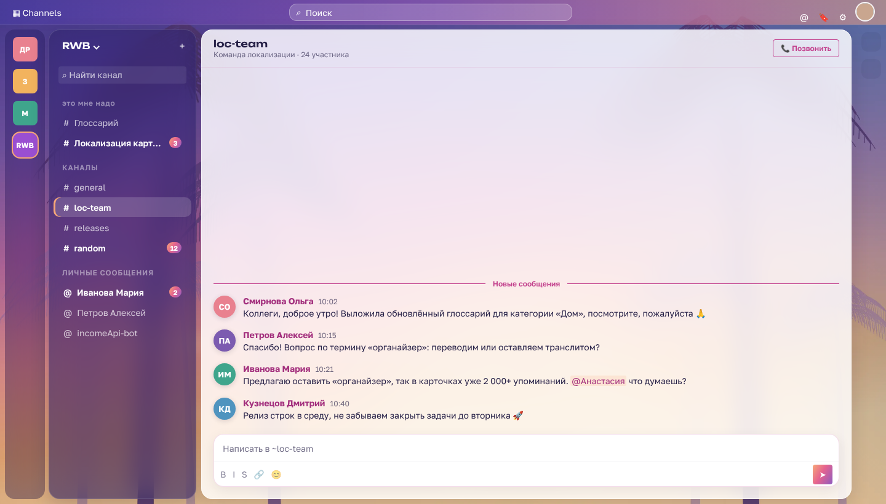
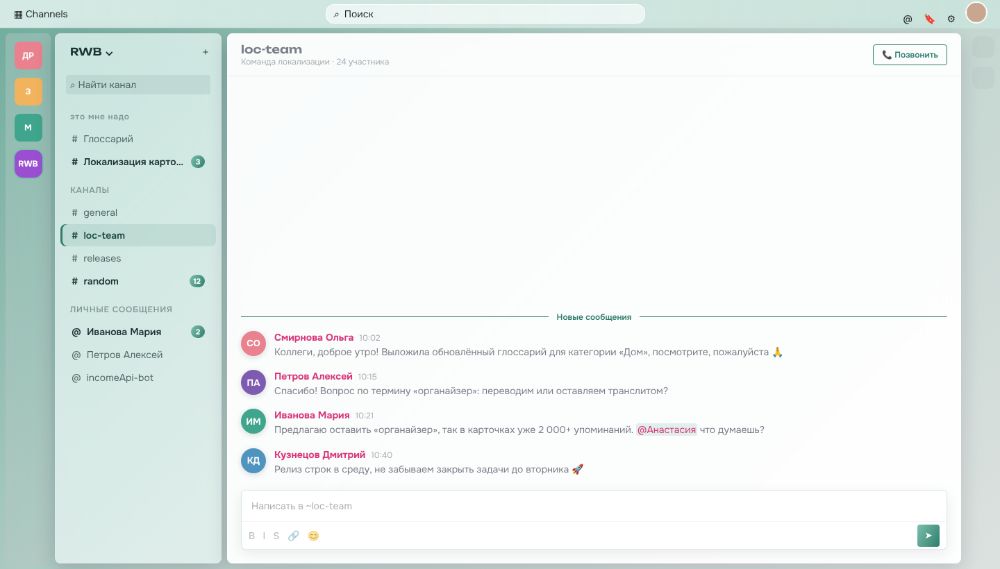
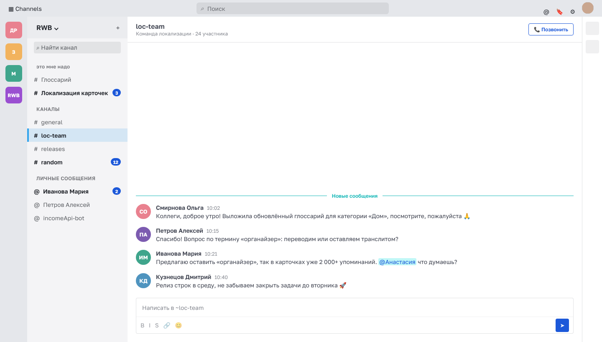
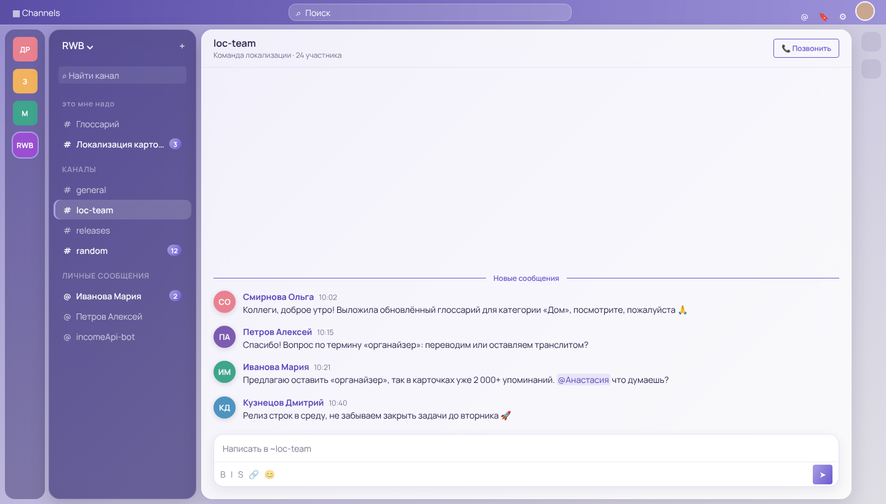
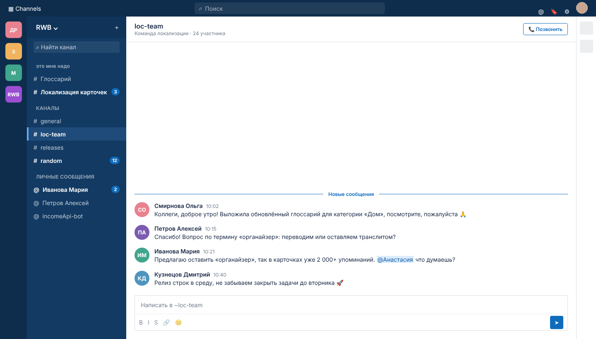

# Band Restyle

Отдельное расширение для Chrome (и Яндекс Браузера), которое меняет внешний вид Band — `https://band.wb.ru`.
Band работает на Mattermost; расширение меняет только оформление, функции не трогает. Работает в браузере,
в настольное приложение Band расширения не ставятся.

## Что умеет

- **Стиль «Стекло»:** обои на весь экран, колонка команд, список каналов и окно чата — полупрозрачные карточки
  с размытием и скруглёнными углами; градиентные кнопки и бейджи, активный канал «таблеткой».
- **Стиль «Только цвета»:** меняется палитра и шрифт, без обоев и карточек.
- **Темы:** Вайс-Сити (закат и пальмы), Хэллоуин (тыквы, луна, чёрные коты), Облако, Пудра, Шалфей, Лаванда, Свой цвет (палитра из двух выбранных цветов)
  и «Как было». Палитра применяется ко всем цветам Band сразу — включая окна, меню и упоминания.
- **Свои картинки для фона:** загружаются на странице настроек и хранятся только в этом браузере.
- **Шрифты:** 13 шрифтов интерфейса (Golos Text, Inter, Manrope, Onest, Montserrat, Nunito, Rubik, Roboto, Jost, Raleway, Exo 2, Comfortaa и исходный)
  и 9 декоративных для заголовков и приветствия (Unbounded, Rubik Wet Paint, Lobster, Caveat, Pacifico, Russo One, Rubik Bubbles, Amatic SC, Press Start 2P).
- **Баннер над чатом:** приветствие, дата и своя картинка (сворачивается кнопкой).
- **Утренняя сводка** в баннере: сколько упоминаний, сколько тредов ждут ответа, каналы с упоминаниями — клик открывает канал.
- **Быстрые статусы:** «Обед», «На созвоне», «Не за компом», «Фокус» — статус ставится в Band со сроком и сам снимается;
  набор кнопок меняется в настройках.
- **Личные заметки** к каналу или человеку — стикер в углу чата (в цветах темы или классический жёлтый), видна только тебе.
- **Заметные отметки прочтения:** «прочитано» — яркие галочки цвета темы, «доставлено» — серая; при наведении подсказка, по клику Band показывает, кто прочитал.
- **«Кто прочитал» окошком:** список прочитавших открывается маленьким окном возле галочек, а не панелью справа; закрывается кликом мимо или Esc.
- **Текст на баннере:** белый, тёмный (для светлых картинок) или свой цвет.
- Данные для сводки, статусы и имя берутся из API самого Band под твоим входом; наружу ничего не отправляется.
- **Настройки под себя:** тёмная или светлая боковая панель, затемнение фона, размытие стекла, непрозрачность окна чата,
  скругление углов, цвет текста на верхней панели (белый, тёмный, свой), свой цвет имён авторов и ссылок.

| Как было | Лаванда | Только цвета, Облако |
|---|---|---|
|  |  |  |

Превью сделаны на макете Band с выдуманными каналами и сообщениями.

## Установка

1. Распакуйте архив — получится папка `band-restyle`. Положите её куда-нибудь насовсем.
2. Откройте страницу расширений: `browser://extensions` (Яндекс Браузер) или `chrome://extensions` (Chrome).
3. Включите **Режим разработчика** и нажмите **Загрузить распакованное расширение** → выберите папку `band-restyle`.
4. Откройте или обновите Band и нажмите на значок расширения, чтобы выбрать тему, шрифт и фон.

## Файлы

- `manifest.json` — описание расширения (работает только на `band.wb.ru`).
- `palettes.js` — темы, перевод палитры в цвета Band, стили «Стекла», шрифты.
- `content.js` — вставляет стиль на страницу.
- `features.js` — баннер, сводка, быстрые статусы и заметки.
- `settings.html`, `settings.css`, `settings.js` — окошко расширения и страница настроек.
- `vice-sunset.webp`, `halloween.webp` — фоны тем «Вайс-Сити» и «Хэллоуин» (нарисованы для этого расширения).
- `fonts/` — шрифты (SIL Open Font License, тексты лицензий рядом).
