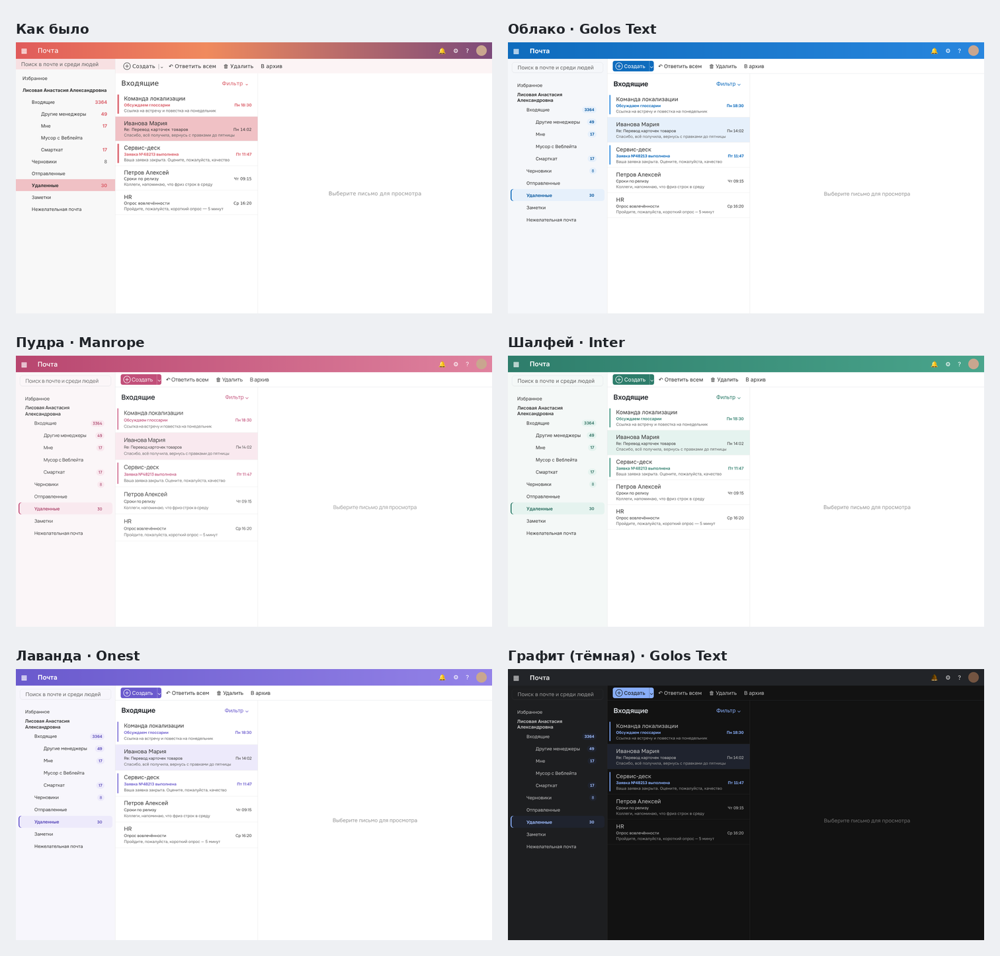

# OWA Restyle

Расширение для Chrome (и Яндекс Браузера), которое меняет внешний вид веб-почты Outlook на `https://mail.rwb.ru`.
Функции почты не меняются: расширение только накладывает свои стили поверх страницы.

## Что умеет

- **Темы:** Облако (синяя), Пудра (розовая), Шалфей (зелёная), Лаванда (фиолетовая), Графит (тёмная, бета) и «Как было».
- **Шрифт интерфейса:** Golos Text, Inter, Manrope, Onest, Segoe UI Variable (есть в Windows 11) или исходный Segoe UI.
  Письма и окно написания письма остаются в шрифтах Outlook (Calibri и т. п.).
- Вместо картинки в шапке ровная заливка, аккуратные бейджи счётчиков непрочитанного,
  выделение папки «таблеткой», заметная кнопка «Создать», тонкие скроллбары, мягкие тени у меню.

Тема и шрифт переключаются по клику на значок расширения, страница обновляется сразу.

## Установка

1. Скачайте папку `owa-restyle` (на GitHub: **Code → Download ZIP**, затем распакуйте архив).
2. Откройте в браузере `chrome://extensions` (в Яндекс Браузере: `browser://extensions`).
3. Включите **Режим разработчика** (переключатель справа вверху).
4. Нажмите **Загрузить распакованное расширение** и выберите папку `owa-restyle`.
5. Откройте или обновите почту и нажмите на значок расширения, чтобы выбрать тему и шрифт.

Если на рабочем компьютере установка расширений запрещена политиками, нужно обратиться в IT.

## Если что-то выглядит не так

Расширение опирается на классы страницы OWA. После обновления почтового сервера часть стилей может перестать
применяться: тогда сохраните страницу почты (Ctrl+S, «Веб-страница полностью», лучше с открытой пустой папкой)
и пришлите её вместе со скриншотом.

Тёмная тема сделана инверсией цветов страницы, поэтому картинки в письмах возвращаются в исходный вид,
а вот цветной текст в письмах может выглядеть иначе.

## Файлы

- `manifest.json` — описание расширения (Manifest V3, работает только на `mail.rwb.ru`).
- `themes.js` — палитры тем, шрифты и сборка CSS.
- `content.js` — вставляет стиль на страницу почты.
- `popup.html`, `popup.css`, `popup.js` — окошко выбора темы и шрифта.
- `fonts/` — шрифты (лицензия SIL Open Font License, тексты лицензий рядом).
- `preview/` — превью тем на макете интерфейса.
