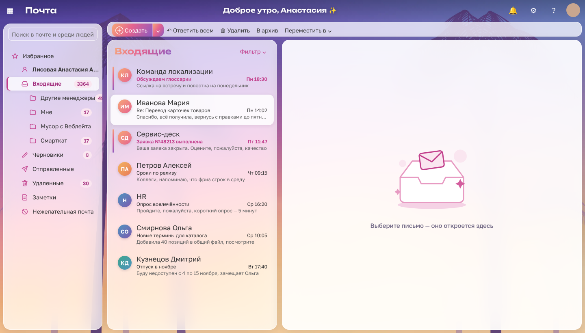
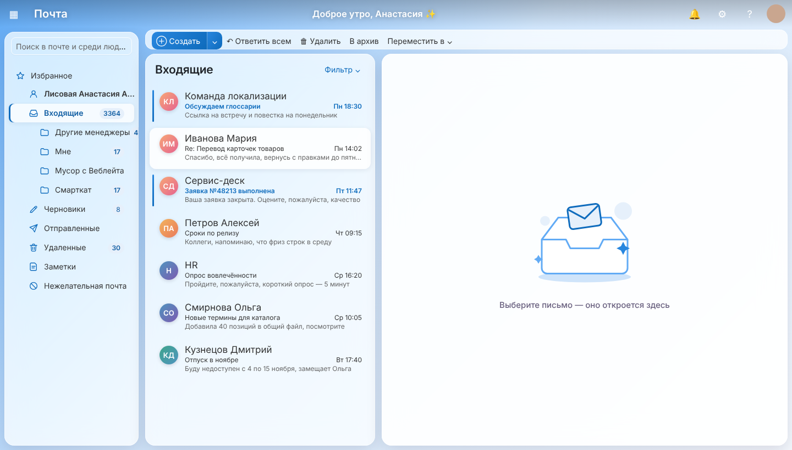
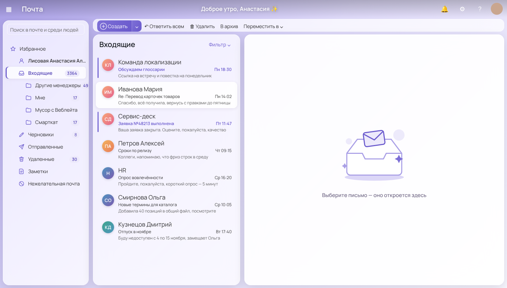
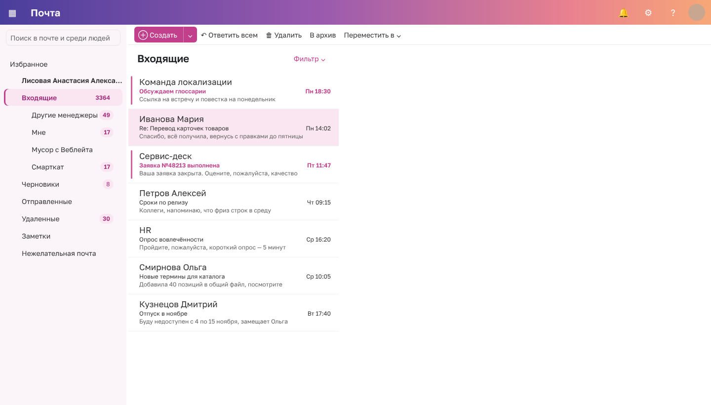

# OWA Restyle

Расширение для Chrome (и Яндекс Браузера), которое меняет внешний вид веб-почты Outlook на `https://mail.rwb.ru`.
Функции почты не меняются: расширение только накладывает свои стили и украшения поверх страницы.

## Что умеет

**Два стиля:**

- **Стекло** — обои на весь экран, папки, список писем, панель команд и область чтения превращаются
  в полупрозрачные карточки с размытием. Плюс украшения: аватарки с инициалами у писем, иконки у папок,
  приветствие в шапке («Добрый день, Анастасия ✨»), иллюстрации в пустых папках и в пустой области чтения.
  Высокая **шапка** из двух карточек: слева баннер со своей картинкой и приветствием с датой, справа виджет
  (тоже можно со своей картинкой) с кнопками OWA и
  датой, числом непрочитанных и **созвонами на сегодня** из календаря: сводка вроде «4 созвона сегодня, следующий в 15:00», текущий подсвечен, у следующего — «через N мин». В **области чтения**, пока письмо не открыто, может стоять своя картинка.
- **Классика** — только цвета темы и шрифт, без обоев и карточек.

**Темы:** Вайс-Сити (закат и пальмы), Хэллоуин (тыквы, луна, чёрные коты), Облако, Пудра, Шалфей, Лаванда, Графит (тёмная, только в классике) и «Как было».
**Свой цвет:** тема, у которой вся палитра собирается из выбранного основного цвета и второго цвета для градиентов.

**Цвет текста:** текст в шапке — белый, тёмный (для светлых картинок) или свой; заголовки и акценты — по теме или свой цвет.

**Свои картинки:** на странице настроек можно загрузить сколько угодно своих картинок и выбрать,
какая будет фоном, какая — в шапке, а какая — в области чтения. Есть и своя картинка для пустых папок. Картинки хранятся только в этом браузере.
Яркость и размытие стекла настраиваются ползунками.

**Шрифт интерфейса:** Golos Text, Inter, Manrope, Onest, Segoe UI Variable (есть в Windows 11) или исходный Segoe UI.
Письма и окно написания письма остаются в шрифтах Outlook.

| Облако | Лаванда | Классика + Вайс-Сити |
|---|---|---|
|  |  |  |

Превью сделаны на макете интерфейса с выдуманными письмами.

## Установка

1. Скачайте папку `owa-restyle` (на GitHub: **Code → Download ZIP**, затем распакуйте архив).
2. Откройте в браузере `chrome://extensions` (в Яндекс Браузере: `browser://extensions`).
3. Включите **Режим разработчика** (переключатель справа вверху).
4. Нажмите **Загрузить распакованное расширение** и выберите папку `owa-restyle`.
5. Откройте или обновите почту и нажмите на значок расширения.

Чтобы загрузить свои картинки, в окошке расширения нажмите **«+ Загрузить свою»** или **«Все настройки ↗»**:
откроется страница настроек, где можно выбрать сразу несколько файлов.

Если на рабочем компьютере установка расширений запрещена политиками, нужно обратиться в IT.

## Если что-то выглядит не так

Расширение опирается на классы и раскладку страницы OWA (версия сервера 15.2). После обновления почтового сервера
часть стилей может перестать применяться: тогда сохраните страницу почты (Ctrl+S, «Веб-страница полностью»,
лучше с открытой пустой папкой) и пришлите её вместе со скриншотом.

## Файлы

- `manifest.json` — описание расширения (Manifest V3, работает только на `mail.rwb.ru`).
- `themes.js` — темы, шрифты и сборка CSS для стиля «Классика».
- `glass.js` — стиль «Стекло»: карточки, обои, иконки, иллюстрации.
- `content.js` — вставляет стиль на страницу почты, рисует аватарки, приветствие и встречи.
- `meetings.js` — берёт встречи на сегодня из календаря OWA (запрос к тому же серверу под текущим входом).
- `settings.html`, `settings.css`, `settings.js` — окошко расширения и страница настроек.
- `vice-sunset.webp`, `halloween.webp` — фоны тем «Вайс-Сити» и «Хэллоуин» (нарисованы для этого расширения).
- `fonts/` — шрифты (лицензия SIL Open Font License, тексты лицензий рядом).
- `preview/` — превью.
